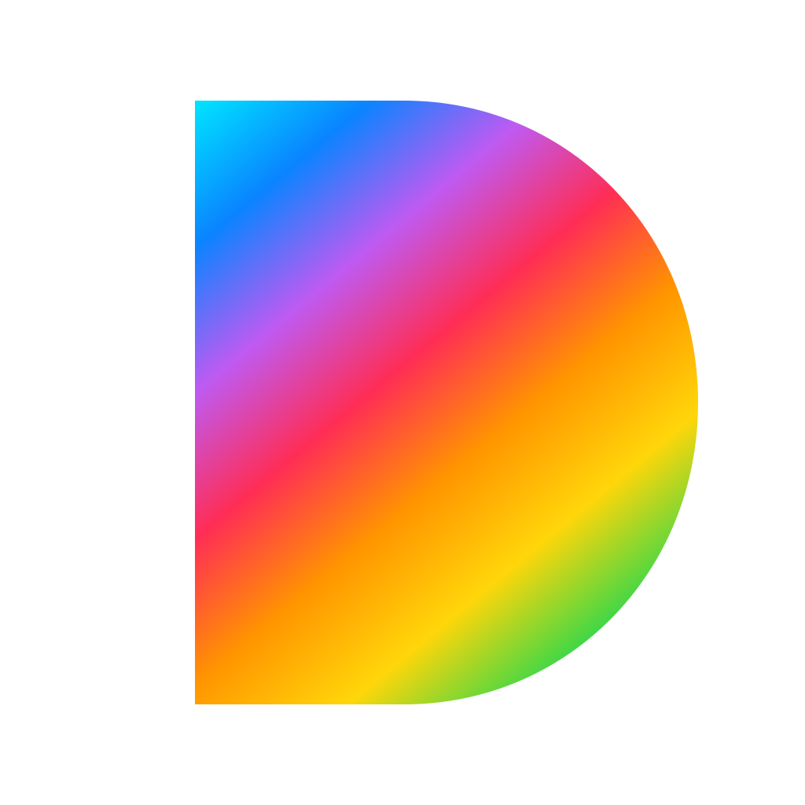

<div align="center">



<br/>

# Dx: Enhanced Development Experience

**One company. One toolchain. Every surface of the development workflow.**

[](https://github.com/essencefromexistence-dx)
[](https://github.com/essencefromexistence-dx?tab=repositories)
[](crates/zed/Cargo.toml)
[](rust-toolchain.toml)
[](https://www.producthunt.com/posts/dx)

<br/>

<table>
  <tr>
    <td align="center"><a href="#-the-dx-toolchain">🧰 The toolchain</a></td>
    <td align="center"><a href="#-dx-code">💻 Dx Code</a></td>
    <td align="center"><a href="#-all-dx-tools">📦 All DX tools</a></td>
    <td align="center"><a href="#-how-the-tools-fit-together">🔗 How they fit</a></td>
  </tr>
  <tr>
    <td align="center"><a href="#-quick-start">⚡ Quick start</a></td>
    <td align="center"><a href="#-repository-map">🗺️ This repository</a></td>
    <td align="center"><a href="#-documentation">📖 Documentation</a></td>
    <td align="center"><a href="#-license-and-lineage">⚖️ License &amp; lineage</a></td>
  </tr>
</table>

</div>

<br/>

<a id="the-dx-toolchain"></a>

<div align="center">

## 🧰 The Dx toolchain

</div>

Dx is a family of developer tools. This repository is the public face of that
family and ships **Dx Code**, the company's AI-native code editor. The other
tools live in their own repositories under the
[essencefromexistence-dx](https://github.com/essencefromexistence-dx)
organization, and the `dx` CLI is the entry point that installs, updates and
routes to them.

| Layer | What belongs to it |
| --- | --- |
| Entry point | `dx` CLI — installs and launches the toolchain from one registry |
| Editor | `dx-code` — Dx Code, this repository |
| Developer tools | check, DCP, driven, forge, grimoire, serializer, style, token, tree, script, i18n, icon, www |
| Media | media, metasearch, video-player |
| Platform | os |

> Each tool is independently versioned and published. Binary names and install
> paths are declared in `TOOL_REGISTRY` in `cli/src/update_registry.rs` in the
> hub; the tables below use that registry plus the repository's own description
> as the source of truth.

<br/>

<a id="dx-code"></a>

<div align="center">

## 💻 Dx Code

</div>

**Dx Code** is the flagship editor: an AI-native development surface with a
GPUI-rendered workspace, agent panels, a web-preview pane that serves the
bundled Dx web projects, DX-specific panels (media, search, check, skills,
plugins, forge) and local model providers.

| Fact | Value | Source |
| --- | --- | --- |
| Binary | `dx-code` | `crates/zed/Cargo.toml:58` |
| Toolchain | Rust `1.98.1` | `rust-toolchain.toml` |
| Workspace | 263 top-level crates | `crates/` |
| Published web bundles | 15 under `assets/web/` | `assets/web/` |
| Local config | `.dx/code` | `crates/paths/src/paths.rs:533` |

<div align="center">


</div>

The AI screen's launcher opens the bundled web workspaces in the preview pane.
The static bundles that the editor serves live in `assets/web/`.

| Bundle | Bundle | Bundle |
| --- | --- | --- |
| `3d` | `Presentations` | `router` |
| `cms` | `shader` | `Design` |
| `graph` | `Spreadsheets` | `Graphics` |
| `media` | `Train` | `metasearch` |
| `music` | `Video` | `whiteboard` |

<br/>

<a id="all-dx-tools"></a>

<div align="center">

## 📦 All DX tools

</div>

### Entry point and developer surfaces

| Tool | Repository | Binary / route | What it does |
| --- | --- | --- | --- |
| **Dx CLI** | [`cli`](https://github.com/essencefromexistence-dx/cli) | `dx` / `dx-cli` | Mission control for the terminal: installs and updates the registered tools, drives media and file browsing, and carries the Codex-grade TUI experiments. It is the hub entry point for the whole toolchain. |
| **Dx Code** | [`dx`](https://github.com/essencefromexistence-dx/dx) | `dx-code` | This repository — the AI-native editor with the bundled web workspaces, agent screens, DX panels and local model providers. |

### Engineering and build tools

| Tool | Repository | Binary / route | What it does |
| --- | --- | --- | --- |
| **Check** | [`check`](https://github.com/essencefromexistence-dx/check) | `dx-check` / `dx check` | Project-health engine. Lint, format, structure, web performance, E2E readiness and launch scoring are collected into one machine-readable receipt. |
| **DCP** | [`dcp`](https://github.com/essencefromexistence-dx/dcp) | `dx-dcp` / `dx dcp` | Development Context Protocol — a binary-first replacement for MCP as the context transport between tools and agents. |
| **Driven** | [`driven`](https://github.com/essencefromexistence-dx/driven) | `dx-driven` / `dx driven` | Professional AI-assisted development orchestrator with a binary-first architecture for repeatable agent workflows. |
| **Forge** | [`forge`](https://github.com/essencefromexistence-dx/forge) | `dx-forge` / `dx forge`, `dx add` | Fast version control for massive media assets — tracks large binary collections that ordinary source control handles badly. |
| **Grimoire** | [`grimoire`](https://github.com/essencefromexistence-dx/grimoire) | `dx-grimoire` / `dx grimoire` | Reverse engineering from the terminal or an agent. One CLI and MCP server for binaries, applications and runtime behavior. |
| **Serializer** | [`serializer`](https://github.com/essencefromexistence-dx/serializer) | `dx-serializer` / `dx serializer` | Token-efficient serialization for LLM context windows, with high-performance binary encoding. |
| **Style** | [`style`](https://github.com/essencefromexistence-dx/style) | `dx-style` / `dx style` | Binary-first CSS engine using zero-copy parsing and DX Serializer output. |
| **Token** | [`token`](https://github.com/essencefromexistence-dx/token) | `dx-token` / `dx token` | Counts tokens across files and folders with multiple tokenizers and a rainbow TUI output. |
| **Tree** | [`tree`](https://github.com/essencefromexistence-dx/tree) | `dx-tree` / `dx tree` | Fast cross-platform directory-tree visualizer for inspecting large project trees. |
| **Script** | [`script`](https://github.com/essencefromexistence-dx/script) | `dx-script` / `dx script` | Command runner for the DX ecosystem — the shared way to invoke DX workflows consistently. |
| **i18n** | [`i18n`](https://github.com/essencefromexistence-dx/i18n) | `dx-i18n` / `dx i18n` | Multi-provider translation engine with Google, DeepL and other translation APIs, plus TTS/STT workflows. |
| **Icon** | [`icon`](https://github.com/essencefromexistence-dx/icon) | `dx-icon` / `dx icon` | Icon search backed by FST indexes and semantic search — the catalog behind DX icon panels. |
| **www** | [`www`](https://github.com/essencefromexistence-dx/www) | `dx-www`; `dx www`, `dx new`, `dx dev`, `dx run`, `dx graph`, `dx deploy` | Rust-owned web framework and server runtime for React and Next-familiar `tsx` apps. |
| **Skilltune** | registry entry only | `dx-skilltune` / `dx skilltune` | Declared in `TOOL_REGISTRY`; no repository is currently listed under the organization. |

### Media, web and communication

| Tool | Repository | Binary / route | What it does |
| --- | --- | --- | --- |
| **Media** | [`media`](https://github.com/essencefromexistence-dx/media) | `dx-media` / `dx media` | Universal digital asset acquisition: one command fetches any media from anywhere into a consistent local representation. |
| **Metasearch** | [`metasearch`](https://github.com/essencefromexistence-dx/metasearch) | `dx-metasearch` / `dx metasearch` | Fast, privacy-respecting metasearch engine in Rust, inspired by SearXNG. |
| **Video player** | [`video-player`](https://github.com/essencefromexistence-dx/video-player) | `dx-video-player` (staged) | Reliable local media playback, including terminal-rendered video. |
| **OS** | [`os`](https://github.com/essencefromexistence-dx/os) | `dx-os` / `dx os` | System monitor with DX branding for Linux, macOS and Windows. |

<br/>

<a id="how-the-tools-fit-together"></a>

<div align="center">

## 🔗 How the tools fit together

</div>

| Mechanism | Where it is defined | What it guarantees |
| --- | --- | --- |
| Installer contract | `TOOL_REGISTRY` in `cli/src/update_registry.rs` | Maps a short tool name to its repository, binary name and install path |
| Install layout | Windows `%LOCALAPPDATA%\dx\bin` | One `dx-<tool>` executable per registered tool |
| Release assets | `dx-<tool>-<rust-target-triple>[.exe]` | The same artifact naming across the published targets |
| Routing | `dx` manifest at the hub root | Maps short names to local folders for development work |
| Achievements | `docs/<tool>.md` in the hub | One verified page per folder, not a claim about the whole company |

A tool can be staged (present in the registry but not yet published), hidden
(routed only through `dx`), or app-only (no registered binary). The tables above
keep those distinctions instead of treating every repository as a shipped CLI.

<br/>

<a id="quick-start"></a>

<div align="center">

## ⚡ Quick start — Dx Code

</div>

The Dx Code tree pins Rust **1.98.1** in `rust-toolchain.toml`.

```powershell
# Show the available build recipes
just --list

# Build the editor, launch it, and copy the binary to G:\Dx\bin
just run

# Build without launching
just build
```

For the rest of the toolchain, install or update through the `dx` CLI — it reads
the same registry that produced the tables above.

<br/>

<a id="repository-map"></a>

<div align="center">

## 🗺️ This repository

</div>

| Path | Purpose |
| --- | --- |
| `assets/` | Published static bundles, icons and license notices |
| `assets/icons/dx_web_tools/` | Icon set used by the AI-screen launcher |
| `script/`, `tooling/`, `ci/`, `nix/`, `.github/` | Build, verification and CI helpers |
| `justfile`, `.cargo/` | Local build recipes and Cargo target/linker configuration |
| `Cargo.toml`, `Cargo.lock` | Workspace manifest and pinned lockfile |
| `CHANGELOG.md` | Sync history |

<br/>

<a id="documentation"></a>

<div align="center">

## 📖 Documentation

</div>

<table>
  <tr><th align="left">Document</th><th align="left">What it covers</th></tr>
  <tr><td nowrap><b><a href="CHANGELOG.md">CHANGELOG.md</a></b></td><td>Sync and change history for this repository</td></tr>
  <tr><td nowrap><b><a href="justfile">justfile</a></b></td><td>Authoritative local build and launch recipes</td></tr>
</table>

<br/>

<a id="license-and-lineage"></a>

<div align="center">

## ⚖️ License and lineage

</div>

The editor sources in this repository derive from the Zed workspace and are
licensed **GPL-3.0-or-later**; see [`LICENSE-GPL`](LICENSE-GPL),
[`LICENSE-APACHE`](LICENSE-APACHE) and `legal/`. The upstream relationship is
tracked through the `upstream` remote and recorded in `CHANGELOG.md`. Other DX
tools carry their own licensing in their own repositories.

**[⬆ Back to top](#dx-enhanced-development-experience)**

</div>
